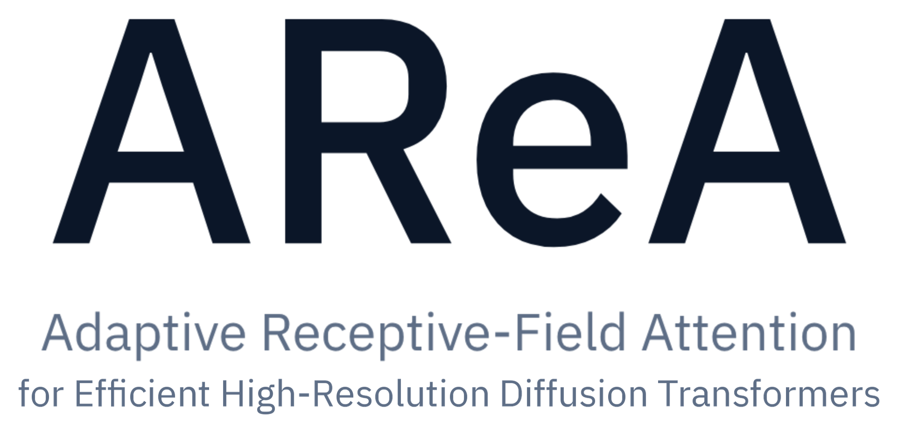

<p align="center">
  <picture>
    <source media="(prefers-color-scheme: dark)" srcset="assets/title-dark.png">
    
  </picture>
</p>

<p align="center">
  <a href="https://rajabi2001.github.io/area/"></a>
  <a href="https://arxiv.org/abs/2610.17227"></a>
  <a href="LICENSE"></a>
</p>

<p align="center">
  <a href="https://huggingface.co/spaces/kooroshrh/AReA"></a>
</p>

<p align="center">
  
</p>

**AReA** is a training-free attention mechanism for generating images beyond the training resolution of diffusion transformers. Attention's effective receptive field narrows during denoising, from global in early steps that form structure to local in later steps that refine details. AReA follows this progression in two phases:

- **Phase I, cross-scale coarse attention.** Queries stay at full resolution while keys and values keep one token per *f × f* block, placed on a grid close to the model's native resolution. Every token still sees the whole image, at 1/*f*² of the cost.
- **Phase II, adaptive windowed fine attention.** Attention runs inside local windows that shrink at every step down to the native size. Windows over smooth regions of a wavelet (DWT) detail map are split into quadrants, a narrow **Halo** of neighbouring tokens extends each window's keys and values, and a **global-KV bridge** adds distinctive tokens from the rest of the image.

AReA never computes full attention at the target resolution and needs no RoPE extrapolation, extra parameters or fine-tuning. It is model agnostic, and its speedup over full attention grows with resolution, up to 3.2× in our experiments.

## News

- **[2026-10-19]** Ideogram 4 support, and `--multi-gpu` to spread a model over several GPUs.
- **[2026-10]** Code released with FLUX.1 support, together with the HRGen-1K benchmark prompts.
- **Coming soon:** Qwen-Image and FLUX.2.

## Supported models

| Model | `--model` | Default checkpoint | Status |
|---|---|---|---|
| FLUX.1 | `flux1` | [`black-forest-labs/FLUX.1-Krea-dev`](https://huggingface.co/black-forest-labs/FLUX.1-Krea-dev) | Available |
| Qwen-Image | | | Coming soon |
| FLUX.2 | | | Coming soon |
| Ideogram 4 | `ideogram4` | [`ideogram-ai/ideogram-4-nf4-diffusers`](https://huggingface.co/ideogram-ai/ideogram-4-nf4-diffusers) | Available |

AReA scales up from a *base resolution*: Phase I pools keys and values onto a grid that fits it, and Phase II windows shrink down to it. The base is 1024 px for FLUX.1. For Ideogram 4, whose native resolution is 2048 px, it is 1024 px up to 4096 × 4096 and 2048 px, the largest it can be, above. AReA works best for targets about 3× the base or more.

## Installation

```bash
git clone https://github.com/KooroshRH/AReA.git
cd AReA

# Install PyTorch for your CUDA version first, then:
pip install -r requirements.txt
```

Model weights are downloaded from Hugging Face on first use. Some checkpoints are gated: accept their license on Hugging Face and log in with `huggingface-cli login`.

## Quick start

To try AReA without installing anything, use the [Hugging Face demo](https://huggingface.co/spaces/kooroshrh/AReA) (FLUX.1, 2K to 4K).

```bash
python generate.py --model flux1 \
  --prompt "A vibrant village with colorful houses and a picturesque castle is set against a backdrop of mountains and a clear blue sky" \
  --height 4096 --width 4096 --seed 0
```

The image is written to `outputs/`. `--model` selects the model (see [Supported models](#supported-models)), and each model runs with its own default checkpoint, number of steps and guidance scale. `--checkpoint` loads another checkpoint of the same model, given as a Hugging Face repo id or a local path:

```bash
python generate.py --model flux1 --checkpoint black-forest-labs/FLUX.1-dev \
  --prompt "..." --height 4096 --width 4096
```

With `--model ideogram4`, the prompt is first expanded by Ideogram 4's prompt enhancer.

On GPUs with less than 60 GB of memory, idle models are offloaded to the CPU automatically. `--multi-gpu` spreads the model over all visible GPUs instead, for canvases that do not fit on one.

## Using AReA in your own code

AReA attaches in place to a [diffusers](https://github.com/huggingface/diffusers) pipeline of a supported model, and the pipeline is then called as usual. For example, with FLUX.1:

```python
import torch
from diffusers import FluxPipeline
from area import AReA

pipe = FluxPipeline.from_pretrained("black-forest-labs/FLUX.1-Krea-dev", torch_dtype=torch.bfloat16)
pipe.vae.enable_tiling()
pipe.to("cuda")              # or pipe.enable_model_cpu_offload()

area = AReA(pipe)

image = pipe(
    "A vibrant village with colorful houses and a picturesque castle",
    height=4096,
    width=4096,
    num_inference_steps=28,
    guidance_scale=4.5,
    generator=torch.Generator("cuda").manual_seed(0),
).images[0]
image.save("village.png")

area.remove()                # back to the original attention
```

For Ideogram 4, load the pipeline with `area.pipelines.SlimIdeogram4Pipeline` instead of diffusers' `Ideogram4Pipeline`; it uses the same weights and fits much larger canvases in memory.

Canvases at or below the model's native resolution keep the original attention. Height and width must divide into whole patches, and the two patch counts must share a factor of at least 2, since Phase I pools *f × f* blocks.

## Options

| `AReA(...)` argument | `generate.py` flag | Default | Description |
|---|---|---|---|
| `pooling` | `--pooling` | `subsample` | Phase I: the token kept for each *f × f* block. `subsample` (block centre), `mean`, `medoid` or `random`. |
| `switch_sigma` | `--switch-sigma` | per model | Noise level σ\* at which Phase II takes over: Phase II starts at the first step whose σ is at or below σ\*. FLUX.1 0.89 (step 8 of 28), Ideogram 4 0.92 (step 20 of 48 at 4096 × 4096). |
| `halo` | `--halo` | 8 | Largest Halo width δ<sub>max</sub>, in patches. |
| `bridge_ratio` | `--bridge-ratio` | 0.5 | Global-KV bridge ratio ρ: each window of side *w* gets (ρ*w*)² bridge tokens. |
| `seed` | `--seed` | 0 | Seed for window boundary jitter, Halo widths and `random` pooling. `generate.py` uses the generation seed. |

The switch is a noise level rather than a step count because models differ in noise schedules and step counts (Appendix A.3 of the paper), so one σ\* lands on different steps for different models, step counts and, for Ideogram 4, resolutions. To try AReA on another model, search σ\* between 0.86 and 0.96, where the defaults of the models we tuned lie, instead of reusing another model's number of Phase I steps.

Other `generate.py` flags: `--model`, `--checkpoint`, `--height`, `--width`, `--steps`, `--guidance`, `--offload`, `--multi-gpu`, `--output-dir`, and `--prompt-file` to generate a whole prompt list. Run `python generate.py --help` for details and defaults.

## HRGen-1K

[`HRGen-1K/prompts.jsonl`](HRGen-1K/prompts.jsonl) holds the 1,000 prompts of HRGen-1K, our benchmark for high-resolution generation. The prompts span natural scenes, built environments, people, animals, objects and imaginative worlds, and target failure modes that single-subject prompts rarely reveal: complex scenes with many interacting subjects, spatial relations, explicit object counts, reflections and transparency, and 125 text-rendering prompts. Prompt length ranges from 9 to 91 words (32.5 on average). Each line is a JSON object with an `id` and a `prompt`:

```bash
python generate.py --model flux1 --prompt-file HRGen-1K/prompts.jsonl --height 4096 --width 4096 --seed 0
```

## Repository layout

```text
AReA/
├── area/
│   ├── schedule.py      # Phase I pooling ramp and Phase II window sizes
│   ├── attention.py     # cross-scale coarse attention and windowed fine attention
│   ├── tiling.py        # base tiling, DWT detail map, splits, Halo, merge weights
│   ├── bridge.py        # global-KV bridge token selection
│   ├── multi_gpu.py     # spreading a model over several GPUs
│   ├── backbones/       # one adapter per model family
│   └── pipelines/       # memory-efficient pipelines (Ideogram 4)
├── generate.py          # command-line generation
├── HRGen-1K/            # benchmark prompts
└── assets/
```

The method lives in the model-independent modules; a backbone adapter only describes how a model lays out its tokens and positions, so supporting a new model means adding one adapter.

## AReA-Bootstrap

AReA-Bootstrap is available for FLUX.1 only. It replaces Phase I with a generation at the native resolution, as multi-stage methods do: the native-resolution latent is upsampled to the target size, re-noised to the level at which Phase II begins, and denoised with Phase II.

```bash
python generate.py --model flux1 --prompt "..." --height 4096 --width 4096 --bootstrap
```

```python
image = area.bootstrap("...", height=4096, width=4096, seed=0).images[0]
```

## Citation

```bibtex
@misc{rajabi2026area,
      title={AReA: Adaptive Receptive-Field Attention for Efficient High-Resolution Diffusion Transformers},
      author={Javad Rajabi and Koorosh Roohi and David B. Lindell and Babak Taati},
      year={2026},
      eprint={2610.17227},
      archivePrefix={arXiv},
      primaryClass={cs.CV},
      url={https://arxiv.org/abs/2610.17227},
}
```
